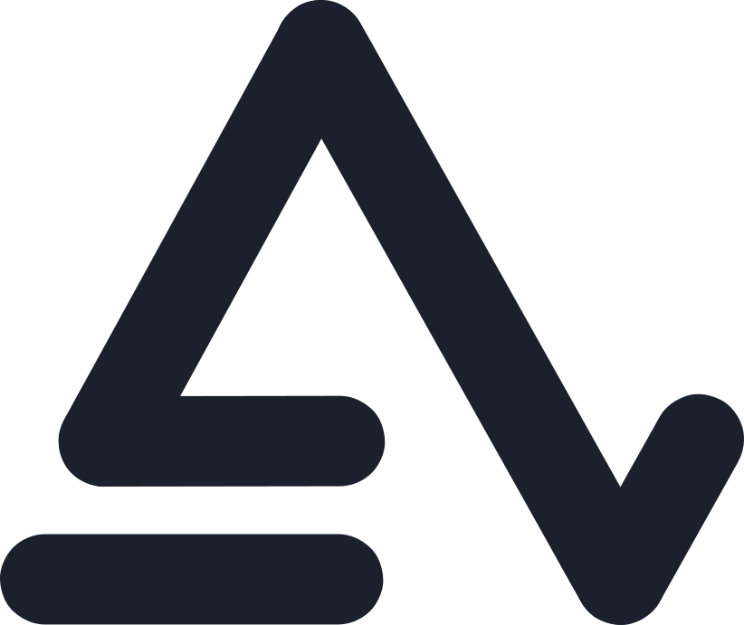
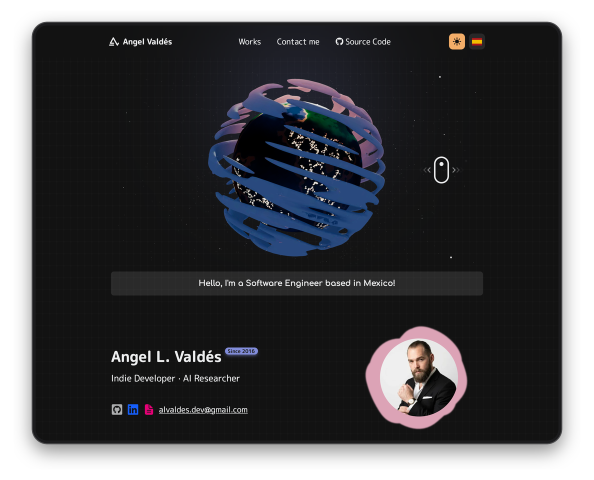
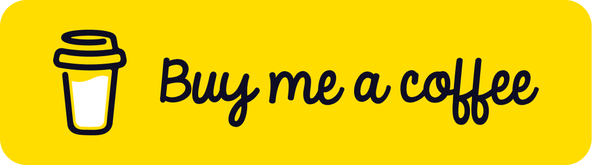

<div align="center">




-61DAFB?logo=react&logoColor=white&style=flat)
[](https://buymeacoffee.com/alvaldes)

<h2>My Personal Portfolio</h2>



</div>

A static, bilingual (Spanish/English) portfolio built with Astro. It is a port of the previous Next.js version that ships HTML first: only the 3D planet on the home page runs JavaScript, so the projects pages load with almost none.

## 🚀 Quick start

Requires **Node.js 22.23.4+** (Astro 7) and **[Bun](https://bun.sh/)**.

```bash
git clone https://github.com/alvaldes/portfolio.git
cd portfolio
bun install
bun run dev
```

Open [http://localhost:4321](http://localhost:4321) (Spanish) or [http://localhost:4321/en/](http://localhost:4321/en/) (English).

## 🧞 Commands

| Command           | Action                                                        |
| :---------------- | :------------------------------------------------------------ |
| `bun install`     | Install dependencies                                          |
| `bun run dev`     | Start the dev server at `localhost:4321`                      |
| `bun run build`   | Type-check with `astro check`, then build the site to `dist/` |
| `bun run preview` | Serve the production build locally                            |

## 🛠️ Stack

| Tool | Role |
| :--- | :--- |
| [Astro 7](https://astro.build/) | Static site generation, native i18n routing, content collections, Markdown, image optimization (`astro:assets`) |
| [Tailwind CSS 4](https://tailwindcss.com/) | Styling through the Vite plugin; theme tokens live in `src/styles/global.css` |
| [React 19](https://react.dev/) + [React Three Fiber](https://docs.pmnd.rs/react-three-fiber) | Only for the 3D planet and stars island, loaded with `client:visible` |
| [lite-youtube](https://github.com/justinribeiro/lite-youtube) | Click-to-load YouTube player on project pages |

## ✨ Features

- 🌍 **i18n:** Spanish at `/`, English under `/en/`, with `hreflang` alternates and a language switcher. On Vercel, `/` sends visitors whose browser does not prefer Spanish to `/en/`, unless they picked a language with the switcher (remembered in a `lang` cookie). Requests without `Accept-Language`, such as crawlers, stay on `/`. Legacy `/es/...` URLs redirect permanently to the unprefixed routes. All rules live in `vercel.json`.
- 🎨 **Themes:** Dark and light mode, saved per visitor, applied before the first paint (no flash).
- 🎭 **3D banner:** Interactive Earth and stars, loaded only when the banner is visible.
- 🖼️ **Optimized images:** Responsive `srcset` generated at build time.
- 🔤 **Self-hosted fonts:** M PLUS Rounded 1c and Comfortaa, no requests to Google Fonts.
- ✍️ **Blog:** Posts in Spanish and English written in Markdown, styled by the site theme (headings, lists, quotes, tables, code with light and dark highlighting, footnotes). Each post is its own canonical URL with its cover as the social preview, so copies on Medium or other sites can point back to it.
- 🔗 **Link previews:** Every page shares a 1200×630 card in its language (`public/og/`); posts share their cover instead.
- 📬 **Contact form:** Opens the visitor's mail client, with a plain `mailto:` form as the no-JavaScript fallback.

## ⚡ Compared with the Next.js version

Measured on production builds in Chromium, cache disabled, CPU throttled 4x, median of 3 runs on localhost (no network latency).

| Page | JS (gzip) Next → Astro | LCP Next → Astro | Page weight Next → Astro |
| :--- | :--- | :--- | :--- |
| Home | 720 KB → 332 KB | 1504 ms → 392 ms | 6.0 MB → 4.2 MB |
| Projects | 723 KB → **0 KB** | 1400 ms → 136 ms | 3.2 MB → 290 KB |
| Project detail | 725 KB → **3 KB** | 1324 ms → 136 ms | 3.2 MB → 262 KB |

The home page stays the heaviest because of the 3D model (~1.6 MB) and three.js.

## 🌐 Routes

| Route             | Description                |
| :---------------- | :------------------------- |
| `/`               | Home (Spanish)             |
| `/en/`            | Home (English)             |
| `/works/`         | Projects listing (Spanish) |
| `/en/works/`      | Projects listing (English) |
| `/works/[id]/`    | Project detail (Spanish)   |
| `/en/works/[id]/` | Project detail (English)   |
| `/blog/`          | Posts listing (Spanish)    |
| `/en/blog/`       | Posts listing (English)    |
| `/blog/[slug]/`   | Post (Spanish)             |
| `/en/blog/[slug]/` | Post (English)            |

## 📁 Project structure

```text
/
├── docs/                    # Images used by this README (not deployed)
├── public/                  # Served as-is: favicon, fonts, 3D model, flags, social cards (og/)
├── src/
│   ├── assets/              # Images optimized at build time by <Image>
│   │   └── projects/<id>/   # thumbCard, thumbFirst, thumbMockup (and videoPoster) per project
│   ├── components/          # Astro components (Navbar, Footer, Home, Work*, ...)
│   │   ├── icons/           # SVG icon paths and icon components
│   │   └── islands/         # React components that run in the browser (3D canvas)
│   ├── content/
│   │   ├── blog/<slug>/     # es.md, en.md and the post's images
│   │   ├── projects.json    # Data every language shares for each project
│   │   └── works/<id>/      # es.md, en.md: short description and long description
│   ├── content.config.ts    # Content collection schemas
│   ├── i18n/
│   │   ├── locales/         # es.json, en.json: all interface copy
│   │   └── utils.ts         # t(), getDictionary(), localized paths
│   ├── layouts/Layout.astro # Page shell: head, backdrop, navbar, footer
│   ├── lib/blog.ts          # Posts in a language, reading time, dates
│   ├── lib/projects.ts      # Projects in a language, image lookup, YouTube id parsing
│   ├── pages/               # Routes: Spanish at the root, English under en/
│   └── styles/global.css    # Tailwind entry, theme palette, fonts, animations, post styles
└── astro.config.mjs         # Site URL, i18n locales, React and Tailwind setup
```

## ➕ Adding a project

1. Add an entry to `src/content/projects.json` with a new `id` and the next `order` (the position on the Works page). The images are file names, such as `"thumbCard": "thumbCard.webp"`.
2. Put `thumbCard.webp`, `thumbFirst.webp` and `thumbMockup.webp` in `src/assets/projects/<id>/`. The build fails if a referenced image is missing.
3. Write `src/content/works/<id>/es.md` and `src/content/works/<id>/en.md`: `shortDescription` in the frontmatter, the long description as the Markdown body. A project without a public website can set `websiteNote` (for example, "university campus network") instead of `website`.
4. Optional: `video` (YouTube URL or a file in `public/videos/`), `channel` and `videoPoster` (a 16:9 image in `src/assets/projects/<id>/`).
5. Run `bun run build`: a page is generated at `/works/<id>/` and `/en/works/<id>/`.

> The build fails if a project is missing a language file, a language file has no project, or two projects share the same `order`.
>
> The type of translation keys is derived from `es.json` only, so `astro check` does not catch a key missing from `en.json`. Keep both files in sync.

## ✍️ Writing a post

1. Create `src/content/blog/<slug>/`. The folder name is the URL: `/blog/<slug>/` and `/en/blog/<slug>/`.
2. Add the cover image to the folder and write `es.md` and `en.md` with this frontmatter:

   ```yaml
   ---
   title: "How I set up my terminal"
   description: "One or two sentences, shown on the listing and in link previews."
   pubDate: 2026-11-02
   cover: ./cover.webp
   coverAlt: "What the cover shows"
   tags: ["Tools"]
   draft: true
   ---
   ```

3. Write the post in Markdown below the frontmatter. Images next to the post work with relative paths, such as ``.
4. Run `bun run dev` and open the post: drafts show up in development only. `src/content/blog/markdown-style-guide/` is a draft with every supported element.
5. Remove `draft: true` (in both files) to publish it. The newest post is featured on the listing.

> The build fails if a post is missing a language, or its languages disagree on `pubDate`, `updatedDate` or `draft`. Set `updatedDate` when you revise a published post.
>
> When cross-posting to Medium, import the post from its URL (or set the canonical link to it) so search engines credit the portfolio.

## 🔑 License

MIT

## Show your support

Give a ⭐ if you like this website!

<a href="https://buymeacoffee.com/alvaldes"></a>
