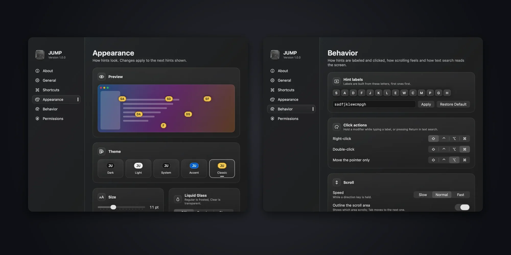

In the browser I barely touch the mouse. I use [Surfingkeys](https://github.com/brookhong/Surfingkeys), an extension that puts a label on every link and button: I type the label and that's the click. Over the years I built my whole setup around the keyboard, and Vim's `h j k l` keys are muscle memory by now.

The trouble started when I left the browser. To click a single button in Finder, System Settings or any other app, I had to let go of the keyboard, reach for the mouse and come back. A few milliseconds, sure. But it happens many times a day and it adds up, and I'm a productivity nerd: those milliseconds matter to me.

That's where [JUMP](https://alvaldes.github.io/jump/) came from.

## What it does

JUMP is a macOS menu bar app. Press a shortcut and every clickable element in the focused window gets a short label. Type the label and JUMP clicks it.

| Shortcut | Mode | What it does |
| :--- | :--- | :--- |
| <kbd>⌘</kbd> <kbd>⇧</kbd> <kbd>Space</kbd> | Hints | Labels every clickable element. Type a label to click it. |
| <kbd>⌘</kbd> <kbd>⇧</kbd> <kbd>J</kbd> | Scroll | Scrolls the window Vim-style: `h j k l`, `d u`, `gg G`. |
| <kbd>⌘</kbd> <kbd>⇧</kbd> <kbd>F</kbd> | Search | Finds visible text, ignoring case and accents. |

Hold a modifier while typing the label to pick the action: <kbd>⇧</kbd> right-clicks, <kbd>⌘</kbd> double-clicks and <kbd>⌥</kbd> only moves the pointer. All three shortcuts and the modifiers can be changed in Settings.



## Why I didn't use something that already existed

The first thing I did was look around. I found two options:

- [Vimac](https://github.com/nchudleigh/vimac), open source, but untouched since December 2022.
- [Homerow](https://www.homerow.app), its commercial successor: it works well, but it's paid and closed source.

Neither felt right, so I thought: why not build my own tool, the way I like it, free and open source? I'm an open-source fan. I like the community that grows around a project and the idea of sharing what you learn. JUMP starts from Vimac's code, which is GPL-3.0, modernizes it for macOS 26 and ships under the same license.

## How it works under the hood

**The Accessibility API.** macOS exposes every app's interface as a tree of elements: buttons, fields, links. JUMP walks that tree in the focused window, keeps what can be acted on and draws the labels on top. That's why it needs the Accessibility permission.

**OCR as a fallback.** Some windows don't expose their text through Accessibility, like terminals or PDFs. For those, JUMP can recognize the text on screen with the Vision framework. It's off by default, asks for the Screen Recording permission only when you turn it on, and the captures never leave memory.

**No Mac App Store.** Store apps run in a sandbox, and an app that reads and drives other apps through Accessibility can't work from inside one. JUMP ships through GitHub Releases instead.

## Engineering decisions

**The core is its own package.** The logic lives in `JumpKit`, a Swift package that's tested without opening the app:

```bash
swift test --package-path Packages/JumpKit
```

Testing something that depends on other windows and system permissions is hard. Keeping the core apart from the UI makes it testable.

**The permission that vanished on every build.** macOS ties the Accessibility permission to the app's code signature. With the default ad-hoc signature, the signature changes on every build and the permission is gone. The fix was signing with my own development certificate, and the release script refuses to publish an ad-hoc signed app: users would lose the permission on every update.

**A release you can't get wrong.** The same script also rejects uncommitted changes and untagged commits. I'd rather it fail than ship something I can't reproduce.

## Try it

JUMP needs macOS 26 or later. Download it from [its website](https://alvaldes.github.io/jump/) or from [GitHub](https://github.com/alvaldes/jump).

> It isn't notarized by Apple yet, so macOS blocks it the first time. The [README](https://github.com/alvaldes/jump#install) walks you through opening it.

If you use it and something breaks, or you have an idea to make it better, [open an issue](https://github.com/alvaldes/jump/issues) in the repository. That's what open source is for.
