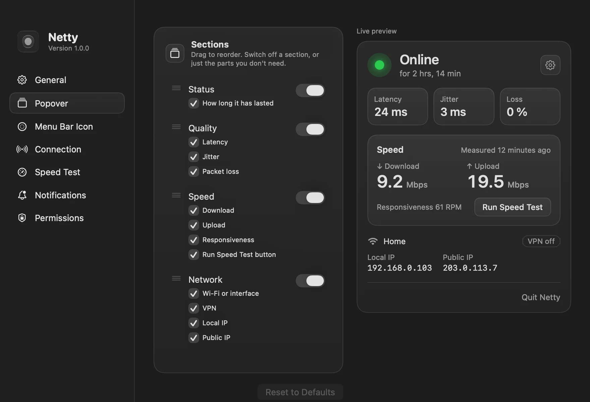

El ícono de Wi-Fi de la barra de menú responde una sola pregunta: ¿estoy conectado a una red? No te dice si internet responde de verdad. La página de inicio de sesión de un hotel, un router que perdió la salida o una conexión que se arrastra se ven igual: todas las barras llenas.

Quería un punto que respondiera la pregunta que importa. ¿Estoy conectado de verdad? ¿La conexión es buena? ¿Qué tan rápida es?

Eso es [Netty](https://alvaldes.github.io/netty/).

## Qué hace

Netty es una app de barra de menú para macOS. Su ícono es un punto que cambia de color según tu conexión:

| Color | Estado | Cuándo |
| :--- | :--- | :--- |
| Verde | En línea | Internet responde y la conexión es buena. |
| Amarillo | Degradada | La latencia, el jitter o la pérdida de paquetes superan un umbral. |
| Rojo | Sin conexión | Fallaron varias comprobaciones seguidas. |

Haces clic en el punto y un popover muestra la latencia, el jitter, la pérdida, la última prueba de velocidad y tu red: nombre del Wi-Fi, Ethernet o hotspot, si una VPN lleva tu tráfico, y tu IP local y pública. Recibes una notificación cuando se cae la conexión y cuando vuelve, con cuánto tiempo estuviste sin internet.

Casi todo se puede cambiar: las reglas del amarillo y el rojo, qué secciones muestra el popover y en qué orden, qué hace cada clic y el propio ícono, a color o en blanco y negro, con SF Symbols o con tu propia imagen.



## Por qué hice la mía

Hay buenas apps que hacen esto, como [Netbar](https://netbar.xyz/) y [Netdot](https://netdot.app/), y [Online Check](https://sindresorhus.com/online-check) resuelve bien la parte de "internet de verdad". Las usé como referencia. Pero quería una gratuita, de código abierto y diseñada con el mismo cuidado que el resto de macOS. Netty se publica bajo GPL-3.0, igual que [JUMP](/blog/introducing-jump/).

## Cómo funciona por dentro

**Internet de verdad, no solo una red.** Netty le pregunta a la comprobación de portal cautivo de Apple, con la de Google como respaldo, si internet responde. Un Wi-Fi sin internet o una página de inicio de sesión cuentan como sin conexión.

**La calidad sale de un handshake TCP.** Cada 10 segundos Netty abre una conexión TCP con 1.1.1.1 y 8.8.8.8 y mide cuánto tarda el handshake. La latencia, el jitter y la pérdida salen de esas muestras. También comprueba al instante cuando cambia la red o cuando haces clic en el ícono, así una caída o una recuperación se confirman enseguida, sin esperar al siguiente intervalo.

**La velocidad, con la herramienta que macOS ya trae.** La prueba de velocidad usa `networkQuality`, que viene con macOS: descarga, subida y capacidad de respuesta. Sin servidores propios. Se ejecuta cuando la pides, o con una programación que viene apagada y se salta las redes de datos limitados.

**Nada sale de tu Mac.** Sin analíticas ni telemetría. Las comprobaciones van a Apple, Google y Cloudflare, y la IP pública se consulta solo cuando abres el popover, como mucho cada 5 minutos. Si la ocultas, nunca se consulta.

## Decisiones de ingeniería

**El núcleo es un paquete aparte.** Las reglas que convierten las muestras en un estado viven en `NettyKit`, un paquete de Swift que se prueba sin abrir la app:

```bash
swift test --package-path Packages/NettyKit
NETTY_LIVE=1 swift test --package-path Packages/NettyKit
```

El segundo comando además sale a la red real y hace una prueba de velocidad. Tenerlo detrás de una variable hace que la suite normal sea rápida y no dependa de tu conexión.

**Revisar la interfaz sin abrirla.** Las builds de depuración pueden renderizar el popover, cada panel de configuración y cada ícono a archivos PNG y cerrarse. Reviso un cambio en modo claro y oscuro, en cada estado, sin recorrer la app a mano. Las capturas de este post salieron de ahí.

**El nombre del Wi-Fi necesita Ubicación.** macOS solo comparte el nombre de la red con apps que tienen acceso a la ubicación. Netty lo pide explicando para qué, nunca lee tu ubicación y sigue funcionando si dices que no: solo muestra "Wi-Fi".

## Pruébala

Netty necesita macOS 26 o posterior. Descárgala desde [su sitio web](https://alvaldes.github.io/netty/) o desde [GitHub](https://github.com/alvaldes/netty), o instálala con Homebrew:

```bash
brew install --cask alvaldes/tap/netty
```

> Todavía no está notarizada por Apple, así que macOS la bloquea la primera vez. [Esta guía](/blog/open-unnotarized-mac-apps/) te explica cómo abrirla.

Si algo falla, o tienes una idea para mejorarla, [abre un issue](https://github.com/alvaldes/netty/issues) en el repositorio.
