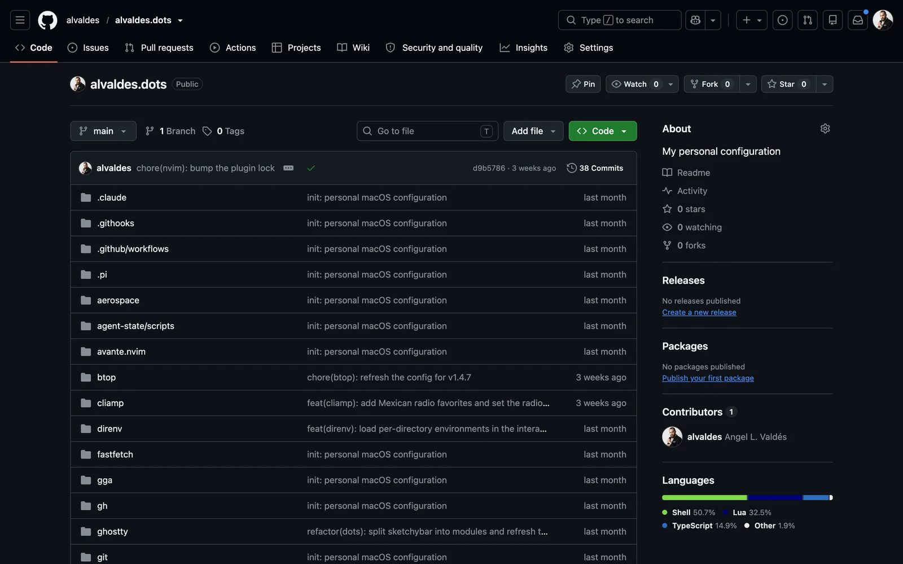
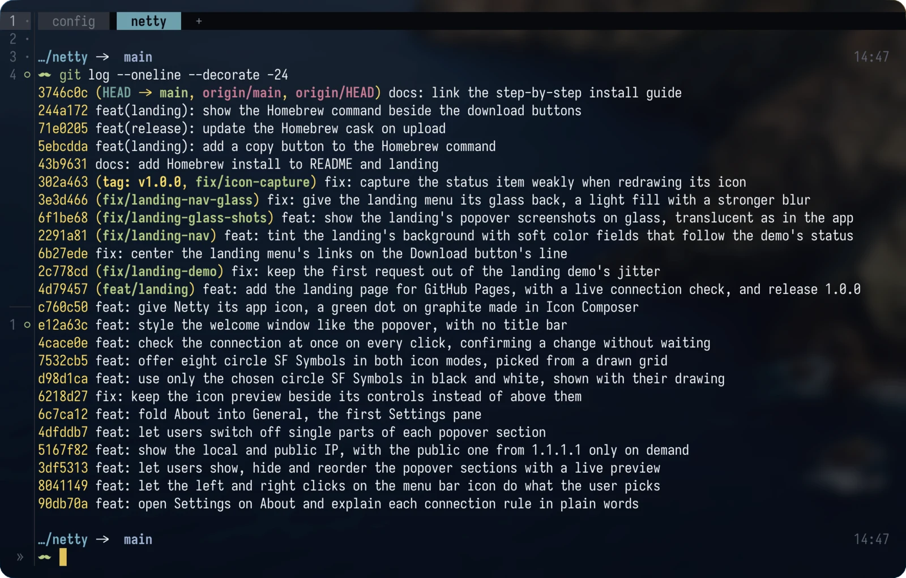
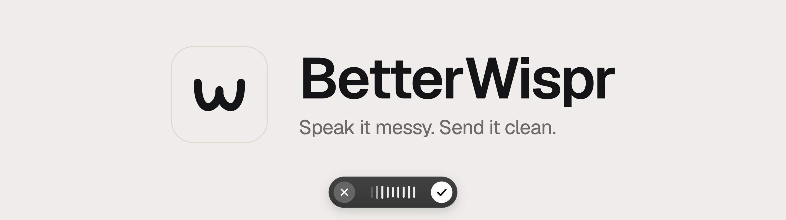
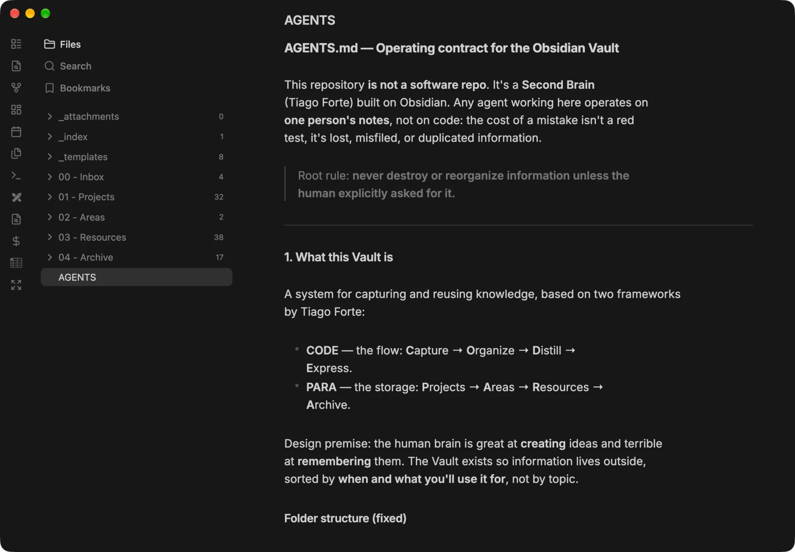

At 12:25 on October 27, Netty was an `idea.md` file. By 22:58 the same day, the app and its landing page existed, with 38 commits in between. By the 30th it had launched.

[Netty](/blog/introducing-netty/) is a macOS menu bar app that tells you whether you're really online. The idea isn't original; similar apps already exist. What was interesting about those four days was something else: how I built it.

I didn't write every line by hand. I also didn't ask an AI to "make me an app" and go grab a coffee. I worked like a project manager with a development team. Each agent was an independent developer that wrote code and tested it; I reviewed it and decided what came next.

The best part was testing. The agent could use the Mac directly and run real integration tests while I watched. And when it came to the website, it could see what it was designing in a real browser. It had hands and eyes.

This post is that workflow, piece by piece.

## The full picture

My stack has eight layers, each with one job:

| Layer | Tool | Its job |
|---|---|---|
| Terminal | Ghostty | Where everything lives |
| Workspaces | herdr | Keeps the agents running in parallel in order |
| Version control | Git and GitHub | Gives each agent its own space |
| Agents | Gentle AI, Gentle Shell, and Engram | Define how the agent works and what it remembers |
| Browser | ego-browser | Gives the agent eyes and hands on the web |
| Voice | BetterWispr | Lets me talk to the agents instead of typing |
| Knowledge | Obsidian | My second brain, shared with the agents |

## The terminal: Ghostty

Almost everything happens in a terminal, so the terminal matters. I use [Ghostty](https://ghostty.org) because it's fast and feels native on macOS, which is exactly what you want from the tool you keep open all day.

Netty was the test. For four days I had several agents working at once, and Ghostty never froze or crashed. The Mac stayed cool, and I kept working in other apps in the meantime.

All my configuration, for Ghostty and for every other tool in this post, lives in my [alvaldes.dots](https://github.com/alvaldes/alvaldes.dots) repo.

## The workspaces: herdr

One agent at a time falls short. While one writes the app, another can build its website. The problem is keeping track of them.

[herdr](https://herdr.dev) is a workspace manager for AI agents in the terminal. Each workspace is a project with its tabs and panes, and herdr detects which agent runs in each one and what state it's in, so you know when one needs you. Sessions stay alive after you disconnect, like tmux, and you can connect to them from another machine.

I pair it with Git. For each agent I create a [worktree](https://git-scm.com/docs/git-worktree): a copy of the repo in its own folder, on its own branch. Each agent works in its worktree without stepping on the others, and at the end I merge each branch and resolve the conflicts.

On Netty I worked with at least two: one for the app and one for the website. The app's agent sometimes split into more agents, one per feature or per independent unit of work.

<video autoplay loop muted playsinline poster="/blog/my-ai-dev-stack/herdr-agents-poster.webp" aria-label="herdr with three Claude Code agents working on Netty in parallel, each in its own worktree. The sidebar shows their state, and the landing page agent asks which layout I prefer before changing anything">
  <source src="/blog/my-ai-dev-stack/herdr-agents.mp4" type="video/mp4">
</video>

## The agent layer: Gentle AI, Gentle Shell, and Engram

An agent without rules is a new developer without onboarding: fast, eager, and able to break things with all the confidence in the world. This layer is the onboarding.

All three tools come from [Gentleman Programming](https://github.com/Gentleman-Programming), Alan Buscaglia's project:

- **[Gentle AI](https://github.com/Gentleman-Programming/gentle-ai)** is a discipline layer for agents. It defines how the agent works: when it asks, when it plans before writing, when it delegates to subagents, which skills it loads, and when it asks for a review before calling something done.

  <video autoplay loop muted playsinline poster="/blog/my-ai-dev-stack/banner-gentle-ai-poster.webp" aria-label="The official Gentle AI banner: a rose with the words Ecosystem, Framework, Workflows">
    <source src="/blog/my-ai-dev-stack/banner-gentle-ai.mp4" type="video/mp4">
  </video>

- **[Gentle Shell](https://github.com/Gentleman-Programming/gentle-shell)** is the workspace built on [Pi](https://pi.dev), a coding agent. It ships Pi with all of Gentle AI already loaded, plus agent orchestration, diff views, and usage monitoring.

  <video autoplay loop muted playsinline poster="/blog/my-ai-dev-stack/banner-gentle-shell-poster.webp" aria-label="The official Gentle Shell banner: a rose with the gentle-shell command and the words Ecosystem, Agent, One shell">
    <source src="/blog/my-ai-dev-stack/banner-gentle-shell.mp4" type="video/mp4">
  </video>

- **[Engram](https://github.com/Gentleman-Programming/engram)** is the memory. An agent forgets everything when the session ends; Engram stores the decisions, the fixed bugs, and the conventions, and the agent gets them back next time.

  <video autoplay loop muted playsinline poster="/blog/my-ai-dev-stack/banner-engram-poster.webp" aria-label="The official Engram banner: an elephant that says remember, sync, and recall, with the tagline One Brain. Local or Cloud.">
    <source src="/blog/my-ai-dev-stack/banner-engram.mp4" type="video/mp4">
  </video>

Engram was key on Netty. I had built [JUMP](/blog/introducing-jump/), another macOS app, before. When Netty started, the agent searched JUMP's memory for the mistakes it had made there and what it had learned, and didn't repeat them. One of those lessons: on JUMP, an unsigned build lost its Accessibility permission on every update. It didn't stop at the current project's context: it went looking in another one of my projects.

Gentle AI does a lot more than fits here. What matters is the idea: the agent doesn't improvise how it works in every session. It always works the same way, and it remembers what it already learned.

## The browser: ego-browser

An agent that writes a web page without seeing it is working blind. It can write correct CSS that looks wrong.

[ego-browser](https://lite.ego.app/) is a Chromium-based browser built for humans and agents alike. The agent drives it from the terminal: it opens pages, clicks, fills in forms, and takes screenshots. And since it's the same browser I use, it has my sessions signed in.

On Netty's website that changed the result. The agent designed, looked at the screenshot, saw what didn't work, and fixed it, without me having to describe every problem.

<video autoplay loop muted playsinline poster="/blog/my-ai-dev-stack/ego-browser-landing-poster.webp" aria-label="An agent goes through the Netty landing page in ego-browser: it checks the download button, takes a screenshot, scrolls through the sections, and opens a question in the FAQ">
  <source src="/blog/my-ai-dev-stack/ego-browser-landing.mp4" type="video/mp4">
</video>

## The voice: BetterWispr

I type less and talk more every day. With a team of agents, much of the work is explaining what I want and what's wrong. Talking, I explain it faster and in more detail than typing.

I use [BetterWispr](https://betterwispr.com/), which is open source and free. I dictate to the agent and the transcription comes out very well. macOS dictation already works, but adding the Parakeet Ultra model, about 730 MB, makes the result much better. It's absolutely worth it, and it barely uses any of the Mac's resources.

## The knowledge: Obsidian

The agents remember with Engram, but I need to remember too. [Obsidian](https://obsidian.md) is my second brain: ideas, projects, and resources in one place.

I organize it with two of Tiago Forte's frameworks. PARA defines where everything goes: Projects, Areas, Resources, and Archive, plus an Inbox at the entrance. CODE defines the flow: capture, organize, distill, and express.

The agents work with it both ways: they read it and they write to it, so the second brain stays up to date without me copying everything over by hand.

Netty started there too, as one more note in the Inbox.

## Netty, end to end

This is how all the pieces came together.

<video controls playsinline preload="metadata" poster="/blog/my-ai-dev-stack/netty-end-to-end-poster.webp" aria-label="Netty end to end in 41 seconds: a sentence from idea.md goes through three agents in herdr, 38 commits on October 27, the landing page checked in ego-browser, and the launch post, all the way to Netty's green dot">
  <source src="/blog/my-ai-dev-stack/netty-end-to-end.mp4" type="video/mp4">
</video>

**The context.** I started by giving the agent references to similar apps that already existed, so it knew the ground we'd be working on. Then I handed it my `idea.md`, the file with all my notes on what I wanted to build.

**The app.** We went feature by feature. Whenever there was a result I could review, I reviewed it, corrected what was needed, and we moved on to the next one.

**The design.** I gave it references for the style I wanted. The agent opened them in ego-browser, studied them, and brought those styles into the app. I kept reviewing along the way.

**The website.** In its own worktree, another agent built the landing page element by element and published it on [GitHub Pages](https://alvaldes.github.io/netty/).

**The launch.** I did all of it with [launch-skills](/blog/launch-skills/), my open-source skills for launching projects, and ego-browser. The agent prepared the kit, generated the images, filled in the directory forms, and drafted the posts for each network. Before each one went out, it stopped and showed me what it was about to send. The last click was always mine.

## An extra: the team in your pocket

The stack works without this, but this takes it further.

[Tailscale](https://tailscale.com) connects the Mac and the phone in a private network. As long as the Mac is on and online, I can reach herdr from my phone, anywhere, and keep talking to the agents without carrying the computer.

On the iPhone side I use [Moshi](https://getmoshi.app/), though other terminal clients such as [Termius](https://termius.com/) work too.

It happened to me many times with Netty. An agent got stuck, told me what was blocking it, and I unblocked it from my phone so it could keep working.

## What changed, and what didn't

Netty went from a note in the Inbox to a published app in four days, and I barely wrote any of the code.

My job is different now. I decide what gets built and in what order. I give each agent the context it needs, from the references to what I learned on JUMP. I review every result before moving on and correct it when it isn't right. I'm a project manager with a team, not a developer with autocomplete.

What didn't change is that someone has to know whether the work is good. An agent is wrong with the same confidence it's right. The tools in this post don't remove that review: they organize it. Worktrees keep the agents from stepping on each other, and ego-browser lets me see every page before I approve it. The last word is still mine.

The agents execute. I direct.

If you want to build something similar, everything in this post is public: my configuration is in [alvaldes.dots](https://github.com/alvaldes/alvaldes.dots), each tool is linked in its section, and [Netty](https://github.com/alvaldes/netty) is open source. And if you work differently, I'd like to hear about it: [write to me](#contact-me) and tell me about your stack.
