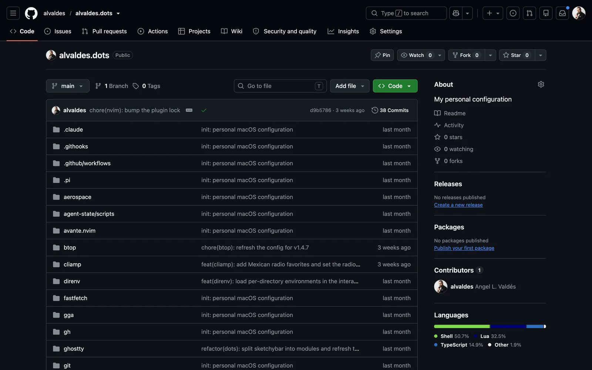
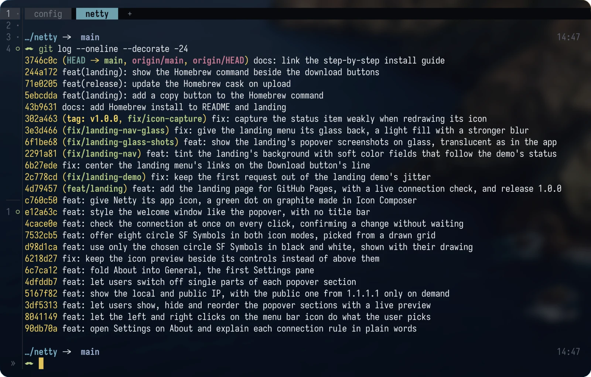
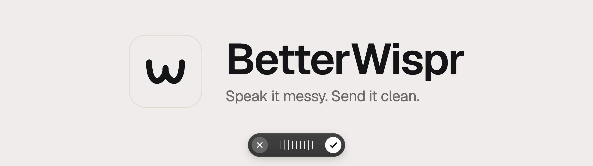
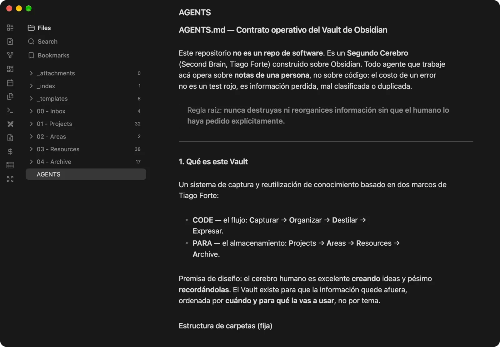

El 27 de octubre a las 12:25, Netty era un archivo `idea.md`. A las 22:58 del mismo día, la app y su landing ya existían, con 38 commits en el medio. El 30 ya estaba lanzada.

[Netty](/es/blog/introducing-netty/) es una app de barra de menú para macOS que te dice si estás conectado a internet de verdad. La idea no es original, ya existen apps parecidas. Lo interesante de esos cuatro días fue otra cosa: cómo la construí.

No escribí cada línea a mano. Tampoco le pedí a una IA "hazme una app" y me fui a tomar un café. Trabajé como un project manager con un equipo de desarrollo. Cada agente era un developer independiente que escribía código y lo probaba; yo revisaba y decidía qué seguía.

La mejor parte fueron las pruebas. El agente podía usar la Mac directamente y correr pruebas de integración reales mientras yo miraba. Y cuando llegó la página web, pudo ver lo que estaba diseñando en un navegador de verdad. Tenía manos y ojos.

Este post es ese flujo de trabajo, pieza por pieza.

## El panorama completo

Mi stack tiene ocho capas, cada una con un trabajo:

| Capa | Herramienta | Su trabajo |
|---|---|---|
| Terminal | Ghostty | Donde vive todo |
| Workspaces | herdr | Ordena los agentes que corren en paralelo |
| Control de versiones | Git y GitHub | Le da a cada agente su propio espacio |
| Agentes | Gentle AI, Gentle Shell y Engram | Definen cómo trabaja el agente y qué recuerda |
| Navegador | ego-browser | Le da al agente ojos y manos en la web |
| Voz | BetterWispr | Me deja hablarles a los agentes en vez de escribirles |
| Conocimiento | Obsidian | Mi segundo cerebro, compartido con los agentes |

## La terminal: Ghostty

Casi todo pasa en una terminal, así que la terminal importa. Uso [Ghostty](https://ghostty.org) porque es rápida y se siente nativa en macOS, que es justo lo que quieres en la herramienta que tienes abierta todo el día.

La prueba fue Netty. Durante cuatro días tuve varios agentes trabajando a la vez, y Ghostty nunca se trabó ni se cerró. La Mac se mantuvo fresca y pude seguir trabajando en otras aplicaciones mientras tanto.

Toda mi configuración, la de Ghostty y la del resto de las herramientas de este post, está en mi repo [alvaldes.dots](https://github.com/alvaldes/alvaldes.dots).

## Los workspaces: herdr

Un agente a la vez se queda corto. Mientras uno escribe la app, otro puede construir su página web. El problema es seguirles el rastro.

[herdr](https://herdr.dev) es un gestor de workspaces para agentes de IA en la terminal. Cada workspace es un proyecto con sus pestañas y paneles, y herdr detecta qué agente corre en cada uno y en qué estado está, así sabes cuándo uno te necesita. Las sesiones siguen vivas aunque te desconectes, como tmux, y puedes conectarte a ellas desde otra máquina.

Lo combino con Git. Para cada agente creo un [worktree](https://git-scm.com/docs/git-worktree): una copia del repo en su propia carpeta y su propia rama. Cada agente trabaja en su worktree sin pisar a los demás, y al final hago merge de cada rama y resuelvo los conflictos.

Con Netty trabajé con dos como mínimo: uno para la app y otro para la página web. El de la app a veces se dividía en más agentes, uno por feature o por unidad de trabajo independiente.

<video autoplay loop muted playsinline poster="/blog/my-ai-dev-stack/herdr-agents-poster.webp" aria-label="herdr con tres agentes de Claude Code trabajando en paralelo sobre Netty, cada uno en su worktree. La barra lateral muestra su estado y el agente de la landing pregunta qué layout prefiero antes de cambiar nada">
  <source src="/blog/my-ai-dev-stack/herdr-agents.mp4" type="video/mp4">
</video>

## La capa de agentes: Gentle AI, Gentle Shell y Engram

Un agente sin reglas es un developer recién llegado sin onboarding: rápido, entusiasta y capaz de romper cosas con toda la confianza del mundo. Esta capa es el onboarding.

Las tres herramientas son de [Gentleman Programming](https://github.com/Gentleman-Programming), el proyecto de Alan Buscaglia:

- **[Gentle AI](https://github.com/Gentleman-Programming/gentle-ai)** es una capa de disciplina para agentes. Define cómo trabaja el agente: cuándo pregunta, cuándo planifica antes de escribir, cuándo delega en subagentes, qué skills carga y cuándo pide una revisión antes de dar algo por terminado.

  <video autoplay loop muted playsinline poster="/blog/my-ai-dev-stack/banner-gentle-ai-poster.webp" aria-label="El banner oficial de Gentle AI: una rosa con el texto Ecosystem, Framework, Workflows">
    <source src="/blog/my-ai-dev-stack/banner-gentle-ai.mp4" type="video/mp4">
  </video>

- **[Gentle Shell](https://github.com/Gentleman-Programming/gentle-shell)** es el workspace construido sobre [Pi](https://pi.dev), un agente de programación. Trae Pi con todo Gentle AI ya cargado, más orquestación de agentes, vistas de diffs y monitoreo de uso.

  <video autoplay loop muted playsinline poster="/blog/my-ai-dev-stack/banner-gentle-shell-poster.webp" aria-label="El banner oficial de Gentle Shell: una rosa con el comando gentle-shell y el texto Ecosystem, Agent, One shell">
    <source src="/blog/my-ai-dev-stack/banner-gentle-shell.mp4" type="video/mp4">
  </video>

- **[Engram](https://github.com/Gentleman-Programming/engram)** es la memoria. Un agente olvida todo al cerrar la sesión; Engram guarda las decisiones, los bugs resueltos y las convenciones, y el agente los recupera la próxima vez.

  <video autoplay loop muted playsinline poster="/blog/my-ai-dev-stack/banner-engram-poster.webp" aria-label="El banner oficial de Engram: un elefante que dice remember, sync y recall, con el lema One Brain. Local or Cloud.">
    <source src="/blog/my-ai-dev-stack/banner-engram.mp4" type="video/mp4">
  </video>

Engram fue clave en Netty. Antes había construido [JUMP](/es/blog/introducing-jump/), otra app de macOS. Al arrancar Netty, el agente buscó en la memoria de JUMP los errores que había cometido ahí y lo que había aprendido, y no volvió a caer en ellos. Una de esas lecciones: en JUMP, un build sin firmar perdía el permiso de Accesibilidad en cada actualización. No se limitó al contexto del proyecto actual: fue a buscar a otro proyecto de mi ecosistema.

Gentle AI hace muchas más cosas de las que caben acá. Lo que importa es la idea: el agente no improvisa su forma de trabajar en cada sesión. Trabaja siempre igual y recuerda lo que ya aprendió.

## El navegador: ego-browser

Un agente que escribe una página web sin verla trabaja a ciegas. Puede escribir CSS correcto que se ve mal.

[ego-browser](https://lite.ego.app/) es un navegador basado en Chromium pensado para humanos y agentes a la vez. El agente lo maneja desde la terminal: abre páginas, hace clic, completa formularios y saca capturas. Y como es el mismo navegador que uso yo, tiene mis sesiones iniciadas.

Con la página de Netty eso cambió el resultado. El agente diseñaba, miraba la captura, veía lo que no funcionaba y lo corregía, sin que yo tuviera que describirle cada problema.

<video autoplay loop muted playsinline poster="/blog/my-ai-dev-stack/ego-browser-landing-poster.webp" aria-label="Un agente recorre la landing de Netty en ego-browser: revisa el botón de descarga, toma una captura, recorre las secciones y abre una pregunta del FAQ">
  <source src="/blog/my-ai-dev-stack/ego-browser-landing.mp4" type="video/mp4">
</video>

## La voz: BetterWispr

Cada vez escribo menos y hablo más. Con un equipo de agentes, gran parte del trabajo es explicar qué quiero y qué está mal. Hablando lo explico más rápido y con más detalle que escribiendo.

Uso [BetterWispr](https://betterwispr.com/), de código abierto y gratis. Le dicto al agente y la transcripción sale muy bien. Con el dictado de macOS ya funciona, pero sumarle el modelo Parakeet Ultra, de unos 730 MB, mejora muchísimo el resultado. Vale totalmente la pena, y casi no consume recursos de la máquina.

## El conocimiento: Obsidian

Los agentes recuerdan con Engram, pero yo también necesito recordar. [Obsidian](https://obsidian.md) es mi segundo cerebro: ideas, proyectos y recursos en un solo lugar.

Lo organizo con dos marcos de Tiago Forte. PARA define dónde se guarda cada cosa: Projects, Areas, Resources y Archive, más un Inbox de entrada. CODE define el flujo: capturar, organizar, destilar y expresar.

Los agentes trabajan con él en los dos sentidos: lo consultan y lo escriben, así el segundo cerebro se mantiene al día sin que yo tenga que pasar todo a mano.

Netty también empezó ahí, como una nota más en el Inbox.

## Netty de punta a punta

Así se juntaron todas las piezas.

<video controls playsinline preload="metadata" poster="/blog/my-ai-dev-stack/netty-end-to-end-poster.webp" aria-label="Netty de punta a punta en 41 segundos: una frase de idea.md pasa por tres agentes en herdr, 38 commits del 27 de octubre, la landing revisada en ego-browser y el post de lanzamiento, hasta el punto verde de Netty">
  <source src="/blog/my-ai-dev-stack/netty-end-to-end.mp4" type="video/mp4">
</video>

**El contexto.** Empecé dándole al agente referencias de apps parecidas que ya existían, para que supiera en qué terreno íbamos a trabajar. Después le pasé mi `idea.md`, el archivo con todas mis notas sobre lo que quería construir.

**La app.** Fuimos feature por feature. Cuando había un resultado que se podía revisar, lo revisaba, corregía lo necesario y pasábamos al siguiente.

**El diseño.** Le pasé referencias del estilo que buscaba. El agente las abrió en ego-browser, las estudió y llevó esos estilos a la app. Yo iba revisando.

**La página web.** En su propio worktree, otro agente fue construyendo la landing elemento por elemento, y la publicó en [GitHub Pages](https://alvaldes.github.io/netty/).

**El lanzamiento.** Lo hice entero con [launch-skills](/es/blog/launch-skills/), mis skills de código abierto para lanzar proyectos, y ego-browser. El agente preparó el kit, generó las imágenes, completó los formularios de los directorios y redactó los posts para cada red. Antes de cada publicación se detenía y me mostraba qué iba a enviar. El último clic siempre fue mío.

## Un extra: el equipo en el bolsillo

El stack funciona sin esto, pero esto lo lleva más lejos.

[Tailscale](https://tailscale.com) conecta la Mac y el teléfono en una red privada. Mientras la Mac esté encendida y con internet, puedo entrar a herdr desde el teléfono, en cualquier parte, y seguir hablando con los agentes sin cargar la computadora.

Del lado del iPhone uso [Moshi](https://getmoshi.app/), aunque otros clientes de terminal como [Termius](https://termius.com/) también sirven.

Con Netty me pasó muchas veces. Un agente se trababa, me avisaba del bloqueo, y yo lo destrababa desde el teléfono para que siguiera trabajando.

## Lo que cambió, y lo que no

Netty pasó de una nota en el Inbox a una app publicada en cuatro días, y yo casi no escribí código.

Mi trabajo ahora es otro. Decido qué se construye y en qué orden. Le doy a cada agente el contexto que necesita, desde las referencias hasta lo que aprendí en JUMP. Reviso cada resultado antes de pasar al siguiente y lo corrijo cuando no está bien. Soy un project manager con un equipo, no un developer con un autocompletado.

Lo que no cambió es que alguien tiene que saber si el trabajo está bien hecho. Un agente se equivoca con la misma seguridad con la que acierta. Las herramientas de este post no eliminan esa revisión: la ordenan. Los worktrees evitan que los agentes se pisen, y ego-browser me deja ver cada página antes de aprobarla. La última palabra sigue siendo mía.

Los agentes ejecutan. Yo dirijo.

Si quieres armar algo parecido, todo lo de este post es público: mi configuración está en [alvaldes.dots](https://github.com/alvaldes/alvaldes.dots), cada herramienta está enlazada en su sección y [Netty](https://github.com/alvaldes/netty) es de código abierto. Y si trabajas distinto, me interesa saberlo: [escríbeme](#contact-me) y cuéntame cómo es tu stack.
