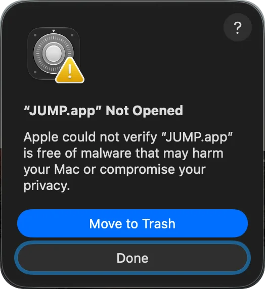
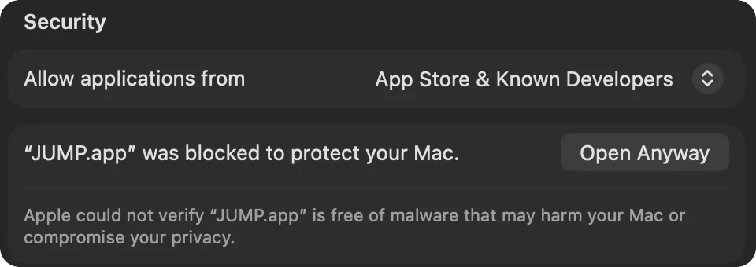
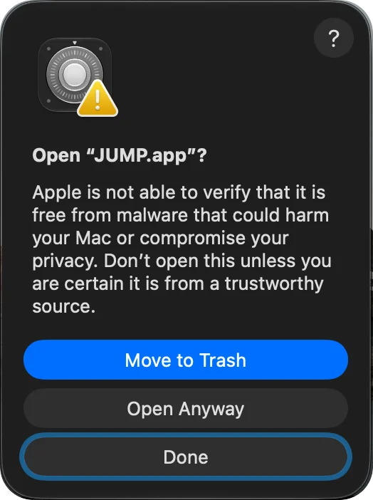

Algunas de las apps que publico, como [JUMP](https://alvaldes.github.io/jump/) y [Netty](https://alvaldes.github.io/netty/), se distribuyen directamente desde GitHub. La primera vez que las abres, macOS las detiene con una advertencia que suena más grave de lo que es. En esta guía explico por qué pasa y cómo resolverlo en un minuto.

## Por qué macOS bloquea la app

Cuando descargas una app fuera de la App Store, macOS revisa dos cosas antes de ejecutarla:

- **Firma**: quién hizo la app y que nadie la modificó después.
- **Notarización**: Apple analizó una copia de la app en busca de malware conocido y la aprobó.

Para notarizar hace falta una cuenta de pago de Apple Developer. Muchos proyectos pequeños y de código abierto todavía no están notarizados, así que macOS no puede verificarlos por su cuenta. Eso no significa que la app sea dañina: significa que Apple no la revisó, y por eso macOS te pide que la confirmes tú.

Desde macOS Sequoia, el truco de hacer clic derecho sobre la app y elegir Abrir ya no funciona. Ahora la confirmación se hace en Configuración del Sistema.

## Cómo abrirla en cuatro pasos

Las capturas muestran JUMP (con macOS en inglés), pero los pasos son los mismos para cualquier app: solo cambia el nombre.

### 1. Abre la app y elige Listo

Abre la app desde Aplicaciones. macOS muestra que no se pudo abrir. Elige **Listo** (Done), no Trasladar a la papelera.



### 2. Ve a Privacidad y seguridad

Abre Configuración del Sistema, entra en **Privacidad y seguridad** y baja hasta **Seguridad**. Junto a “… se bloqueó para proteger tu Mac”, haz clic en **Abrir igualmente** (Open Anyway). Es posible que macOS te pida la contraseña.



El botón aparece durante una hora, aproximadamente, después de intentar abrir la app. Si no lo ves, vuelve al paso 1 y abre la app de nuevo.

### 3. Confirma con Abrir igualmente

macOS pregunta una última vez. Elige **Abrir igualmente**.



### 4. Listo

macOS recuerda tu elección, así que a partir de ahora la app se abre con normalidad. Cuando instales una versión nueva, puede volver a preguntar: repite los mismos pasos.

## Desde la Terminal

Si usas la Terminal con soltura, puedes saltarte los diálogos. macOS marca cada archivo descargado como en cuarentena, y esa marca es la que activa la verificación. Este comando la quita:

```sh
xattr -dr com.apple.quarantine "/Applications/JUMP.app"
```

Cambia la ruta por la de la app que instalaste. Hace lo mismo que los pasos anteriores, así que se aplica la misma regla.

## ¿Es seguro?

La advertencia existe por algo: es tu único control sobre una app que Apple no revisó. Antes de hacer clic en Abrir igualmente, asegúrate de que:

- La descargaste del sitio oficial o de sus releases en GitHub, no de un espejo ni de un enlace que te envió alguien.
- Sabes quién la hizo. En las apps de código abierto, además, puedes leer el código.

Si tienes cualquier duda, elige Trasladar a la papelera. Con las apps en las que confías, estos pasos son todo lo que necesitas.
